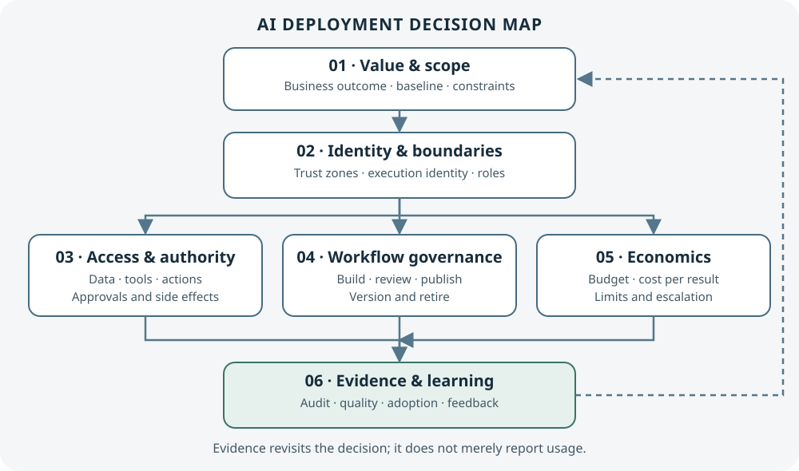

While studying Claude Academy's enterprise deployment course, I found a useful idea: platform configuration is a chain of decisions, not a collection of switches. Change the structure of an organization, and permissions, costs and reporting may change with it.

I wanted to take that idea outside a single product. Whether I am evaluating Claude Enterprise, Microsoft Copilot, an SAP Business AI capability, or an internally built agent, I would ask the same architectural questions. The answers will differ because these platforms have different controls.

My starting point is simple: **an AI rollout is a change to the enterprise operating model, not just a license deployment.** A tool can be useful before it is ready to act on production data. A rollout must account for both.

## My AI Deployment Decision Map

I propose six design areas. The first establishes value and constraints; the next four design the operating boundaries; the last establishes evidence and learning. These are dependencies, not mandatory sequential project phases. In particular, monitoring and safety tests must be ready before real users or production data arrive.

<figure class="system-opening-visual">
  
  <figcaption>My proposed decision map. The identity boundary has a wide impact; operational evidence feeds the next decision rather than ending the rollout.</figcaption>
</figure>

| Decision | Question I would ask | Accountable owner | Required output |
| --- | --- | --- | --- |
| 1. Value & scope | What job should improve, and what must not happen? | Business process owner | Outcome, baseline, constraints |
| 2. Identity & boundaries | Who or what is acting, for whom, and within which data boundary? | IAM / security owner | Boundary and role map |
| 3. Access & authority | What may AI read, propose or change? | Process and system owners | Tool and action authority matrix |
| 4. Workflow governance | Who can build, review, distribute and retire AI workflows? | Platform / AI enablement lead | Lifecycle and release policy |
| 5. Economics | How much value and cost does each workflow produce? | Budget owner | Cost model, limits, escalation |
| 6. Evidence & learning | How will we detect failures, demonstrate control and decide to expand? | Operations and risk owners | Evaluation, audit, metrics and review plan |

The architect connects these decisions, but does not inherit every approval right. Security accepts security risk; finance commits budget; the process owner accepts the business outcome. I would document one accountable decision owner for each record and identify the required approvers.

## 1. Define a useful job before choosing a model

"We need an AI agent" is not a business requirement. "Reduce the time spent investigating failed customer-master replication without allowing AI to change customer data" is a much better starting point.

I would record the current cycle time, quality and failure rate before a pilot. Then I would compare the existing process, a deterministic automation, a read-only AI assistant and a more autonomous solution. If a simple rule or query can reliably solve the problem, I do not need a model for that part.

Define the success measure and the non-negotiable constraint together. More usage is not success if the team spends more time correcting the output.

## 2. Design identity and data boundaries first

An enterprise AI platform needs a clear relationship between people, workloads, groups, roles and data. I prefer the fewest tenants or workspaces that can meet real separation requirements, not one environment for every department.

Separate boundaries may be necessary for contractual isolation, regulatory restrictions, different identity domains or incompatible retention policies. Cost-center reporting and different permissions alone do not automatically justify another tenant. Confirm what the platform actually isolates: content, administration, encryption, identity, billing, logs and exports can have different boundaries.

Before rollout I would check domain ownership, SSO, provisioning and deprovisioning, emergency admin access, and the accuracy of directory groups. SSO authenticates; SCIM can synchronize identities and memberships; neither alone proves that downstream authorization is correct.

I would test effective permissions with overlapping roles. Claude's course describes additive grants; other platforms may support explicit deny or different precedence. Never assume the restrictive group cancels a broad grant. Test contractors, joiners, movers and leavers, including cached tokens and active sessions. Domain claiming, tenant restructuring and live group mappings need a recovery and communication plan before activation.

## 3. Separate access from business authority

A user being able to open a chat interface does not mean the assistant should be allowed to update a sales order. A connector being installed does not mean every action exposed by that connector is appropriate.

I would evaluate an action against several gates: platform policy, effective role, execution identity, source-system permission and action-specific controls. The following is a conceptual policy, not a statement about every vendor's implementation.

```text
Effective authority =
    platform policy
    AND permitted role / workload scope
    AND valid execution identity
    AND target-system authorization
    AND action-specific policy
    AND required approval
```

An agent may run as the user, as a service account or with a shared workspace/channel identity. These are different trust models. In a shared channel, an answer might expose data to people who could not retrieve it themselves. In unattended automation, a service identity may remain active after a human leaves. I would review who can invoke the agent, what it can retrieve, who can see its outputs, and how to revoke it.

For a write action, I would require a scoped API or tool, deterministic validation, approval where needed, duplicate prevention, error handling and a way to reconcile what actually happened. Retrieved content is not permission to execute. An instruction in a document must not override an authorization policy.

My usual progression is read and explain, draft a proposal, execute an approved low-risk action, and only then consider tightly bounded unattended actions. Each step requires evidence; not every workflow needs the final step.

## 4. Govern reusable workflows, not individual prompts

A successful prompt often becomes a skill, a shared project, a plugin or an agent. This is where personal productivity starts to affect other people and systems.

I would allow low-risk experiments in a sandbox, then require review before a workflow becomes a shared standard. A reusable workflow needs an owner, a version, permitted data and tools, test cases, dependencies, a support contact and a retirement plan. Publishing a new version should not silently expand production authority.

There are good reasons for different governance levels. A documentation team can share drafts with light review; a finance automation that posts transactions needs stronger testing and approval. Centralizing all low-risk experiments slows adoption; allowing every untested automation to spread creates hidden operational debt. Keep experimentation easy and promotion deliberate.

## 5. Manage cost per useful result

I would distinguish three things: the total budget, limits assigned to people or workloads, and the actual cost of a useful business result. They are not interchangeable. In particular, a per-member limit inherited from a group is not necessarily a shared group budget.

Agent tasks can include multiple model calls, retrieval, tools, retries and scheduled runs. A token limit or monthly cap protects one part of the bill, but does not make a workflow efficient.

Consider a synthetic incident-triage pilot:

| Measure | Manual | AI-assisted |
| --- | ---: | ---: |
| Cases completed per month | 200 | 200 |
| Average human time per case | 30 min | 12 min |
| Monthly human time | 100 h | 40 h |
| Model and platform incremental cost | $0 | $300 |
| Human time valued at $40/h | $4,000 | $1,600 |
| Illustrative total variable cost | $4,000 | $1,900 |
| Cost per completed case | $20.00 | $9.50 |

These are invented planning numbers, not observed results. The 60 hours of released capacity are worth $2,400 at the assumed rate; after $300 incremental AI cost the theoretical benefit is $2,100. That is not guaranteed cash savings. Integration, maintenance, rework, oversight and fixed license costs must be added to a real business case, and the saved time must be usable. Compare accepted cases at equivalent quality.

If a group hits a limit, I would investigate before raising it: wrong model for routine work, excessive context, repeated retries, idle scheduled jobs, or genuinely more valuable demand? Cost per accepted outcome is more useful than tokens alone.

## 6. Make visibility a launch condition

An audit trail, operational telemetry and business evaluation answer different questions. I would design all three before granting access.

| Evidence | Question answered |
| --- | --- |
| Security audit and action records | Who invoked what, under which identity and policy, and what changed? |
| Operational telemetry | Where are latency, errors, retries and cost increasing? |
| Evaluation records | Did the response or action satisfy the expected business result? |
| Adoption and outcome measures | Are teams using it for useful work, and is the process improving? |

Content logging and metadata logging are different. Retention, redaction, access to logs, deletion, legal hold and data residency need explicit decisions; logs themselves can contain sensitive information. Check the platform's actual coverage. A successful API call is not proof that the business operation succeeded.

I would monitor cost, quality, unsafe-action attempts, incidents and time saved, not just active users. If usage falls, ask about access, training, workflow fit and trust before concluding that the technology failed. If usage grows, check whether accepted outcomes grow too.

## A change-impact example

Imagine a synthetic SAP support organization. Its AI assistant can read approved troubleshooting guides and sanitized replication errors. Support engineers may prepare draft tickets. A master-data team may propose corrections, but an existing approved change workflow owns the actual update. No agent directly modifies master data in the initial pilot.

Now suppose a support engineer joins a restricted finance group. I would trace the change through role memberships, connector access, permitted actions, workflow sharing, spend attribution and audit coverage. I would test the new effective authority and remove obsolete grants, rather than simply adding another group.

When a new AI capability appears inside a collaboration channel, I would run the same analysis again. Does it act as the individual or the channel? Who sees the answer? Are guest users present? Is it billed to the user, the workload or the organization? What does it record? A new interface can change the trust boundary even if it uses the same model.

## What I would approve before go-live

I would run a small pilot against representative and adversarial cases. Each workflow needs a business owner, an authority record, an approved data scope, a cost limit, an evaluation set, operational alerts and a documented stop mechanism. Test unauthorized reads and writes, stale context, prompt injection, duplicate requests and partial failures.

The rollout decision is not "AI enabled." It is **go, conditional go, or hold for a defined workflow and population**. Expansion requires new evidence when the data, audience, autonomy or blast radius changes.

For every important decision I would record the options, recommendation, reason, dependency, change cost, owner, evidence and review trigger. Tenant splits, deletion of records, broad identity migrations and irreversible writes deserve particular care. Reversible switches can still cause disruption when a team depends on them.

## Put it to work

Use the [Enterprise AI Deployment Review working skill](/skill-hub/ai-assisted-analysis/enterprise-ai-deployment-review/) to run a workshop and produce a decision register. It complements the existing [AI Agent Authority Design method](/skill-hub/ai-assisted-analysis/ai-agent-authority-design-working-skill/) and the [ERP Agent Gateway pilot](/labs/business-ai/erp-agent-gateway/).

## Sources and scope

This is my proposed architecture method, developed from a course study and independent design reasoning, not a report of a production deployment or a product certification. The example uses synthetic data. Vendor capabilities, contract terms, legal obligations and technical control coverage must be checked for the actual environment.

- [Claude Academy — Deploying Claude Enterprise with confidence: Five decisions and the frame](https://academy.claude.com/courses/deploying-claude-enterprise-with-confidence/five-decisions-and-the-frame). The starting point for the decision-dependency idea.
- [NIST AI Risk Management Framework](https://www.nist.gov/itl/ai-risk-management-framework). A broader risk-management reference; this article does not claim conformance.
- [FinOps Foundation — Unit Economics](https://www.finops.org/framework/capabilities/unit-economics/). Further reading on connecting cost with measurable value.
