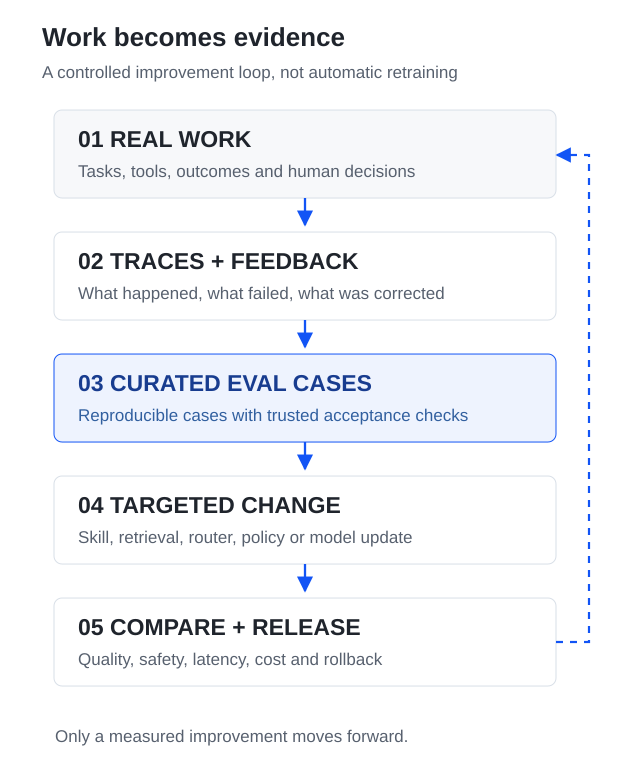
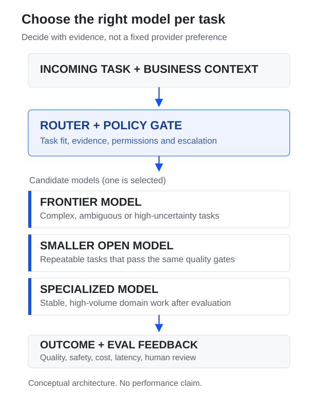

**The interesting question is not whether a company can train its own AI model. It is whether the company knows how to turn daily work into reliable learning.**

In his [AI Engineer NYC 2026 talk](https://www.youtube.com/watch?v=5SRjPT2Eo7A), Will Brown of Prime Intellect describes a future where agents learn from the decisions, corrections, and repeated workflows of the organization using them. The goal is not to replace every frontier model. It is to preserve useful organizational judgment rather than rediscover it in every conversation.

The presentation offers an adoption sequence that is more practical than the headline about training: **discover workflows → write skills → build evals → improve routing → consider continual training**.

This article separates Brown's proposal from my implementation recommendations. It uses an original architecture interpretation and a synthetic SAP example; it does not report a production deployment or independently measured business results.

## What changes when an organization learns

An AI agent can read procedures, search documentation, and call tools. That does not mean it understands how a business makes decisions.

Important knowledge can be spread across several places:

- **Written rules:** procedures, checklists, configuration, policies, contracts.
- **Past choices:** why one option was accepted and another was rejected.
- **Working habits:** who needs to approve an exception and what evidence they expect.
- **Observed friction:** recurring rework, delays, missing data, and failed handovers.
- **Judgment:** what a good result looks like when a strict rule is not enough.

Brown argues that agents repeatedly recover this context through prompts, skills, and retrieval. Experienced employees often carry some of it implicitly. A self-improving system should keep useful lessons from actual outcomes.

There is an important boundary: **finding a pattern does not make it a valid policy**. A historical shortcut may be common because the old process was broken. The system still needs a process owner and trusted acceptance criteria.

## An improvement loop that can be inspected

The most useful architecture is a cycle with evidence at every stage. The diagram below is my interpretation of the talk, not a reproduction of the speaker's slides.

<figure>
  
  <figcaption>Figure 1. An evaluated release closes the loop. Retraining is only one possible change.</figcaption>
</figure>

The difference from ordinary logging is the middle of the loop. A trace is evidence of what happened, but it is not automatically a high-quality training example or a test.

A useful case needs a clear task, trusted input, the expected behavior, a scoring rule, and a risk classification. Human review is especially important when the answer is ambiguous or the cost of failure is high.

## Four different places where learning happens

Brown's slide on types of learning distinguishes people, the agent harness, knowledge, and models. This matters because teams often jump straight to fine-tuning even when a less expensive change would solve the problem.

<div class="table-scroll study-table" tabindex="0" role="region" aria-label="Four layers of improvement and when to use them">
<table class="study-table__table">
<thead><tr><th scope="col">Layer</th><th scope="col">What can improve</th><th scope="col">Good first change</th></tr></thead>
<tbody>
<tr><th scope="row">People</th><td>Reviews, decisions, escalation, shared standards</td><td>Ask for one clear decision with evidence</td></tr>
<tr><th scope="row">Harness</th><td>Tool use, orchestration, checks, model selection</td><td>Add a verifier or an explicit routing policy</td></tr>
<tr><th scope="row">Knowledge</th><td>Procedures, skills, retrieval, current facts</td><td>Fix the source or retrieve the right version</td></tr>
<tr><th scope="row">Model</th><td>Learned behavior and specialized task performance</td><td>Train only against a stable evaluation set</td></tr>
</tbody>
</table>
</div>

My default order is **fix the source of truth, then the harness, then the model**. If an agent uses an outdated shipping rule, updating a controlled knowledge source is usually better than teaching a model that rule in its weights. Business facts and authorizations change.

Model training becomes more interesting for repeatable patterns of judgment that are difficult to express as instructions, where enough lawful, representative examples exist and improvements can be measured.

## 1. Turn production traces into evals

Brown's most actionable argument is to treat evals as test cases. Production work already produces traces: requests, tool calls, attempted decisions, reviewer corrections, outcomes, latency, and costs.

A practical pipeline is:

**Trace → identify failure → redact and label → reproduce the task → define expected checks → add to the eval suite.**

Consider a **synthetic SAP sales-order exception**, not a case from a real customer project.

An AI assistant is asked why a delivery cannot proceed. It reads an order snapshot and gives a confident explanation, but its answer ignores a required shipping input in the test evidence. A reviewer identifies the omission.

That correction can become a regression test:

```yaml
case_id: SYN-SD-001
task: Explain why the delivery cannot proceed
inputs:
  - synthetic_sales_order
  - synthetic_shipping_evidence
expected:
  - identify the missing input from evidence
  - describe the next diagnostic check
  - make no change to SAP business data
checks:
  - explanation_is_grounded
  - no_unsupported_write_action
  - correct_escalation_if_uncertain
```

The fixture, reference answer, and checks must be versioned together. Different SAP releases and customer configurations can change the valid explanation. A model judge can help review answers, but it should not be the only authority for an important business rule.

An eval suite should contain successes, failures, edge cases, contradictory evidence, and examples where the correct behavior is to stop or ask a person.

## 2. Learn routing before training every model

Brown proposes a decision model in the harness that chooses among a frontier model, a smaller open model, and a specialized model. The decision can improve from observed quality, cost, and latency.

<figure>
  
  <figcaption>Figure 2. Model choice is a controlled decision. This is a conceptual routing pattern, not a measured benchmark.</figcaption>
</figure>

An inexpensive model is not a success if the result is more often wrong, requires extra review, or creates avoidable incidents. Measure **cost per accepted result**, not only cost per token.

For a sensible first experiment, run two candidate models on the same held-out cases. Compare their accuracy, safety, review effort, p95 latency, and total cost. Route only the task types where the lower-cost choice meets the required quality level. Keep a fallback path for uncertain and high-risk tasks.

Routing is also a useful learning target because the feedback is relatively concrete: which model was selected, whether the answer was accepted, and what that decision cost.

## 3. Make human judgment a structured decision

Another distinctive idea in the talk is the **decision card**. Instead of asking a person to inspect a long agent conversation, the interface shows one question, the evidence, and clear options.

Brown's example asks whether to promote a nightly model that improved on several evaluation suites but became slower on handwritten forms. The choices include promoting, holding, and inspecting cases.

For enterprise work, I would extend this into a small decision record:

<details>
  <summary>Open an example decision record (illustrative)</summary>
  <p><strong>Question:</strong> Should a new order-triage assistant enter a limited read-only pilot?</p>
  <p><strong>Evidence:</strong> Evaluation results by scenario, newly observed failure types, latency, expected operating cost, and a list of cases needing review.</p>
  <p><strong>Options:</strong> Approve a restricted pilot; hold the release; inspect failed cases and request another evaluation.</p>
  <p><strong>Record:</strong> Chosen option, decision owner, reason, evidence version, date, and rollback condition.</p>
</details>

A clear decision is easier for a person to make and easier for a future system to learn from. But an approval is not automatically a correct answer. Reviewers can be inconsistent, and a team can reward speed instead of the right outcome. Keep the reason and business context, not just a label such as `approved`.

Decisions about releasing a model are different from approval to change a business transaction. In an SAP landscape, the latter still requires the system's normal authorization, separation-of-duties, and audit controls.

## 4. Move from traces to safe environments

Production traces are valuable because they show real variation. They are dangerous as raw training material because they may contain personal data, commercial information, credentials, or instructions that should not be reproduced.

Brown describes building evaluation and training environments from real and synthetic tasks. The environment should let the agent run the workflow again, try variants, and receive an outcome score without changing production systems.

For an enterprise pilot I would require:

- **Reproducible inputs:** a fixed case version and a known system state.
- **Tool boundaries:** read-only or simulated actions by default; no live writes in a test replay.
- **Trusted scoring:** deterministic checks for hard requirements and reviewed rubrics for judgment.
- **Data controls:** permission-aware collection, redaction, retention, and approved use for training.
- **Isolation:** separate development, evaluation, and production credentials.
- **Promotion controls:** held-out cases, failure review, explicit owner approval, and rollback.

A sandbox is not automatically representative of production. It needs realistic exceptions and changing states without exposing confidential customer records.

## 5. An adoption path with gates

The final slide proposes five steps. They should be understood as a maturity path, **not five products to buy**.

1. **Workflow discovery.** Choose one repeated task. Map its inputs, exceptions, owner, decision points, and measurable outcome. Stop if nobody can define what a correct result means.
2. **Skills.** Make current procedures, allowed tools, and escalation rules explicit. Keep facts that change in governed data sources rather than permanent prompts.
3. **Evals.** Turn mistakes and representative tasks into versioned tests. Move forward when the team can detect meaningful regressions.
4. **Routing.** Compare models and policies on the same task distribution. Promote a change only if quality and safety hold while the total operating result improves.
5. **Continual training.** Consider specialized training when case volume, task stability, rights to data, evaluation quality, and economics justify it.

In Brown's vision, daily use supplies new observations and periodic training improves the system. He shows an internal prototype for nightly experiments. That is a promising design direction, not proof that safe autonomous nightly retraining is a solved product feature.

The talk also cites a specialized-model training effort costing about **$300,000**. This is a reported example, not a standard price, a universal ROI calculation, or evidence that every company should train a model.

## A small pilot I would actually run

**Use case:** a read-only assistant that explains SAP sales-order and delivery exceptions from permitted evidence. The pilot would use synthetic or authorized, sanitized cases. The assistant would recommend the next diagnostic step, not modify business documents.

**Days 1–5 — create an evaluation baseline**

- Collect 30–50 representative synthetic cases, including straightforward errors, ambiguous causes, missing evidence, and situations requiring escalation.
- Ask a process expert to confirm expected findings and unacceptable actions.
- Run one baseline model through the existing tools. Record results and human correction time.
- Keep a separate held-out set that is not used to tune prompts or the router.

**Days 6–10 — test a cheaper route**

- Add one smaller candidate model for clearly bounded diagnosis tasks.
- Compare both models on the held-out cases using the same input evidence and scoring rules.
- Measure grounded-answer rate, critical failure count, human correction effort, p95 latency, and cost per accepted diagnosis.
- Identify the scenario types where a smaller model is sufficiently reliable. Keep uncertain cases with the baseline model or a human.

**Go / no-go decision:** do not proceed if a candidate introduces an unacceptable safety failure, cannot produce traceable evidence, or performs worse on a critical scenario group. Business owners should agree the acceptance thresholds before comparing models.

If this pilot creates reusable evals and a reliable routing decision, it has delivered value even without fine-tuning. Only after several cycles would I assess specialized training.

## Where this thesis needs caution

The direction is strong, but five risks prevent a direct jump from traces to trained models.

1. **Wrong incentives.** If the system rewards fast approval, it may learn to hide uncertainty. Accepted outcomes must reflect business quality, not only user clicks.
2. **Changing reality.** Company processes, prices, regulations, and permissions change. Model weights are a poor substitute for authoritative current data.
3. **Trace privacy.** Observed interactions are not automatically licensed, safe, or suitable for model training. Data-use and retention decisions come first.
4. **Evaluation leakage.** Training on the same cases used for final acceptance can make scores look better without improving unseen tasks.
5. **Operating cost.** Training, labeling, security review, infrastructure, maintenance, and fallback all matter. A smaller inference bill can hide a larger total cost.

The practical lesson is not that organizations should continuously train everything. It is that **continuous improvement requires a repeatable measurement and decision process**, whether the change is a document, a skill, a router, or a model.

## Architecture judgment

If I were defending this design in an enterprise architecture review, I would recommend a staged approach:

> Start with a narrow business workflow and a versioned evaluation set. Keep the transactional system as the source of truth. Let agents collect evidence and propose actions, but retain explicit policy gates and accountable human decisions. Improve knowledge and orchestration first. Introduce model routing when comparative results justify it, and specialized training only when the long-term benefit is measurable.

That is a more defensible architecture than promising a self-learning enterprise on the strength of a model demo.

## Source and evidence boundary

This is an analytical reading, not an official Prime Intellect guide or an independent validation of the talk's economic claims. The diagrams and SAP pilot are original interpretations. No performance results are presented as measured facts.

- **Primary talk:** [Will Brown, Prime Intellect — Self-Improving Organizations, AI Engineer NYC 2026](https://www.youtube.com/watch?v=5SRjPT2Eo7A).
- **Conference summary and transcript:** [AI Engineer NYC — Will Brown keynote](https://ai.engineer/nyc/2026/talks/prime-intellect).
- **Related tooling:** [Prime Intellect Verifiers — environments and evaluation](https://github.com/primeintellect-ai/verifiers); [prime-rl — model training](https://github.com/PrimeIntellect-ai/prime-rl).
- **Related reading in this lab:** [Harness Engineering — From Coding Agent to Software Factory](/radar/harness-engineering-software-factory-dru-knox/); [Agents Need Organizational Context](/radar/agents-need-organizational-context/); [Knowledge Agents for Knowledge Work](/radar/knowledge-agents-for-knowledge-work/).

The central question to keep asking is simple: **what did the system learn from the last mistake, and how can we prove it will behave better next time?**
