<nav class="breadcrumbs" aria-label="Breadcrumb">
  <ol><li><a href="/">Home</a></li><li><a href="/frameworks/">Frameworks</a></li><li aria-current="page">Living Documentation Contract</li></ol>
</nav>

<article class="section note-detail atlas-page">
  <header class="note-header">
    
Experimental specification · v0.1 · 6 November 2026

    <h1>Living Documentation Contract</h1>
    
A small, testable agreement between a tool, its documentation, and the reader. Human understanding comes first; machines help keep the evidence current.

    
<a href="/blog/documentation-should-explain-less-prove-more/">Read the research article and comparison</a>.

  </header>
  

## Design target

**A reader should find the right tool, understand its safe use, and make the next correct decision with as little unnecessary reading as possible.**

This is a proposed project convention, not an official industry standard. It adapts established docs-as-code, Diátaxis, OpenAPI, JSON Schema, MCP discovery, and diagram-as-code patterns. It is intended for professionals who already know the basic domain.

The contract separates three layers:

| Layer | Audience | Preferred format | Source of truth |
|---|---|---|---|
| Action card | Human solving one task | Short Markdown, rendered as HTML | Reviewed task content + derived fields |
| Reference | Expert or calling system | JSON Schema, OpenAPI, MCP metadata, or typed manifest | Runtime/API/model definition |
| Evidence | Maintainer or reviewer | Tests, versioned examples, semantic diffs | Executable checks + reviewer decisions |

Never duplicate the same field definition in three independently maintained documents. **Generate shared facts once, then expose the appropriate view.**

## Eight required meanings

Each documented capability MUST have the following information, even if several fields are displayed only on demand.

| Field | Reader's question | Verification boundary |
|---|---|---|
| Identity + version | What am I looking at? | Build/release metadata |
| Purpose + audience | When should I use it? | Editorial review |
| Input + output contract | What do I supply and receive? | Schema + sample executions |
| Preconditions | What must be in place? | Config checks + owner review |
| Limitations | What will it not do? | Review; cannot be inferred from absence |
| Failure + recovery | What breaks, and what is the next safe step? | Test fixtures + incident evidence |
| Example + evidence | Does an example still work? | Executable test with version |
| Owner + freshness | Who maintains the behavior and the page? | Repository ownership + change history |

A public card SHOULD start with **task → inputs/checks → expected result → limits → evidence**. It MAY expand when a shorter form would create a dangerous omission. No universal token ceiling is prescribed.

## Self-description is a capability, not a promise

A CLI MAY implement a structured describe command. A HTTP API SHOULD reuse its OpenAPI document where appropriate. An MCP server uses tools/list to expose the tools available to the caller; that list is **not** an authorization decision or proof of tool safety.

A self-description MUST include what is executable, the relevant version, and any constraints that cannot be derived automatically. Descriptions obtained from a remote or untrusted tool remain untrusted until verified.

**Example:** This repository contains a synthetic SAP logistics pre-check, which reads the same manifest used to validate its example inputs and generate its documentation. It is not an SAP integration or a real route-determination service.

~~~bash
python3 scripts/living_docs_demo.py describe
python3 scripts/living_docs_demo.py inspect --input frameworks/living-documentation/example-order.json
python3 scripts/living_docs_demo.py check
python3 scripts/living_docs_demo.py sync
~~~

The sample input intentionally omits a departure zone. The pre-check reports that omission; it cannot determine the correct route. That distinction is part of the contract.

Inspect the [machine-readable example manifest](https://github.com/dkharlanau/dkharlanau.github.io/blob/main/frameworks/living-documentation/tool-manifest.json), [generated human card](https://github.com/dkharlanau/dkharlanau.github.io/blob/main/frameworks/living-documentation/generated/tool-card.md), [Mermaid source](https://github.com/dkharlanau/dkharlanau.github.io/blob/main/frameworks/living-documentation/generated/change-flow.mmd), [generated SVG](https://github.com/dkharlanau/dkharlanau.github.io/blob/main/frameworks/living-documentation/generated/change-flow.svg), and [Python implementation](https://github.com/dkharlanau/dkharlanau.github.io/blob/main/scripts/living_docs_demo.py).

## Rules for automatic diagrams

Diagrams MUST represent **typed relationships from a semantic source**, not an LLM's guess from prose. A rendering pipeline SHOULD:

1. Validate IDs, entities, relationships, and their types.
2. Select a suitable view: process, handoff, data flow, or decision.
3. Generate a deterministic SVG or versioned Mermaid source.
4. Provide a meaningful text alternative and readable labels.
5. Compare generated output in CI against the committed source.
6. Require review when relationships or business meaning change.

This example uses a tiny deterministic Mermaid projection. For richer SVG diagrams, reuse [Visual Workbench](https://github.com/dkharlanau/visual-workbench) rather than building another layout engine. For business process contracts, examine [Process as Code](https://github.com/dkharlanau/process-as-code), which already has validation, diff, documentation and diagram outputs.

The diagram's logical path is generated from the same manifest:

<figure>
  
  <figcaption>Deterministic SVG projection of the documentation lifecycle. This is not a diagram of SAP route determination.</figcaption>
</figure>

The diagram is **derived evidence about the publication workflow**, not evidence that the SAP business process is correct.

## Update and review protocol

**MUST automate:** schema/manifest validation; derived content regeneration; reproducibility checks; link and diagram validity; executable example checks; version and source references.

**MUST require a reviewer:** change to business meaning; SAP release or configuration assumptions; authorization or destructive-action guidance; externally sourced claims; operational recovery advice; promotion from unverified to verified content.

**MUST NOT:** silently rewrite unsupported statements; mark facts verified from model confidence; execute a tool merely to update a document when the action has side effects; expose secrets, real customer data, or private configuration.

An optional agent MAY open a change proposal based on a diff and supporting evidence. It must not auto-merge material interpretation changes. If the authoritative tool has changed but tests or examples fail, the correct output is a **stale documentation finding**, not an invented explanation.

## Minimal quality gates

| Gate | Passing condition |
|---|---|
| Discovery | A human can locate the capability using its name, task, or common failure |
| Comprehension | Target readers answer a task question without a critical misunderstanding |
| Executability | At least one representative example passes against the specified version |
| Drift | Modifying a derived input or output causes the check to fail until regenerated |
| Visual fidelity | Diagrams come from a validated model and include accessible text alternatives |
| Provenance | Version, source, test evidence, and reviewer-owned claims remain traceable |
| Safety | Restrictions, side effects, and unknowns are visible before risky actions |

**Candidate pilot targets, not proven benchmarks:** compare the new format with the existing page on five to ten expert tasks. Record correct completion, time to first correct action, omissions, and maintainer effort. Token count is a secondary measure.

## Adoption stages

**Stage A — Short and reviewed.** Convert one existing guide into an action card, keep the deeper reference linked, and remove duplicate prose.

**Stage B — Contract-driven.** Generate fields, command help, reference tables, and one diagram from a versioned source.

**Stage C — Drift-detecting.** Test examples, compare generated files, and fail CI on mismatches.

**Stage D — Proposal-driven refresh.** Create evidence-based pull requests for changes; reserve semantic approval for the owning team.

This repository's demonstration implements a small part of **Stages B and C**. It does not claim an automated content-authoring or deployment agent.

## References

The proposal builds on [Google's minimum viable documentation and update-with-code guidance](https://google.github.io/styleguide/docguide/best_practices.html), [Diátaxis](https://diataxis.fr/), [OpenAPI 3.2.1](https://spec.openapis.org/oas/v3.2.1.html), [JSON Schema annotations](https://json-schema.org/understanding-json-schema/reference/annotations), [MCP tool discovery](https://modelcontextprotocol.io/specification/2026-07-28/server/tools), [Backstage TechDocs](https://backstage.io/docs/features/techdocs/), [Mermaid CLI](https://github.com/mermaid-js/mermaid-cli), and [Vale](https://docs.vale.sh/). They support particular layers of the proposal; none on its own guarantees that generated prose matches business reality.

  

</article>
