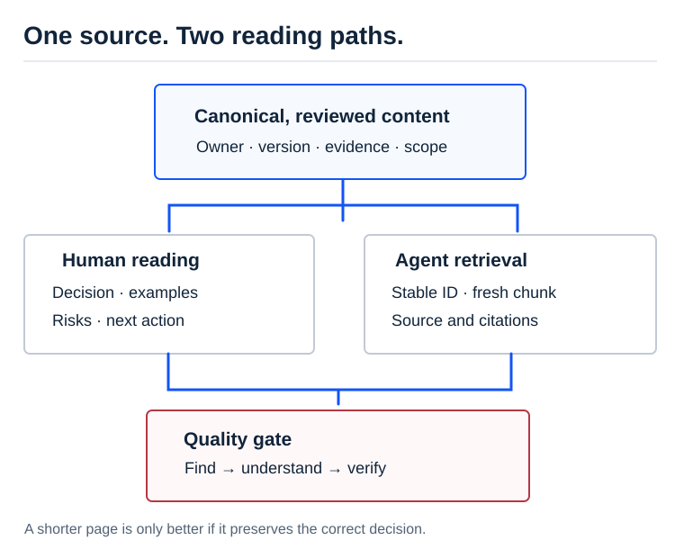

[AI Ready](/labs/ai-ready/) / [Video Lessons](/labs/ai-ready/video-lessons/)

# Documentation for Humans and Agents: Small, Clear, Verifiable

A documentation page can be beautiful and still unusable to an agent. That is the tension in [Most of Your Docs Readers Are Now AI Agents](https://aietalks.com/talks/most-of-your-docs-readers-are-now-ai-agents), a November 2026 AI Engineer discussion with Hahnbee Lee (Mintlify) and Lincoln Murr (Coinbase). The speakers say that visits by agents to Mintlify-hosted docs have risen sharply. That is a vendor-reported traffic observation, not a claim that every website now has the same audience.

The useful design choice is to write **one accurate source** and deliver it through two readable surfaces. A human needs purpose, examples and caveats. An agent needs compact, correctly structured, retrievable facts with stable identifiers. Neither needs pages filled with repeated generic claims.

<figure>

<figcaption>The same source must stay readable to people and precise enough for a retrieval system; editing one view must not silently contradict the other.</figcaption>
</figure>

## The real failure: a precise question finds the wrong paragraph

Suppose a SAP consultant asks: "Does the source BP contain the transport zone, or did replication fail?" A search tool retrieves a page titled *Customer Master Data* that contains 8,000 words of unrelated fields. The model gets a few fragments, misses the ownership rule and invents a cause. Increasing the model's context window does not repair a weak document boundary.

A stronger page answers a specific task: **compare source and target master-data fields without interpreting a blank field as proof of failed replication**. It starts with the decision, then gives relevant field ownership, required evidence, exception states, and links.

| For the human reader | For retrieval and tools |
| --- | --- |
| What problem does this solve? | Stable title, canonical URL, concise description |
| What is the normal process? | One section per answerable task |
| Which alternatives could explain the symptom? | Explicit source of truth, date, system scope |
| What can I check next? | Typed objects, readable tables and short examples |
| What is not yet proven? | Source references and clear uncertainty |

## One source, not two conflicting manuals

A practical documentation contract:

~~~yaml
id: sap-bp-replication-diagnosis
title: Diagnose an out-of-date BP field
scope: synthetic-example
question: Why does the target not show the source value?
sources:
  - source_record_snapshot
  - target_record_snapshot
  - interface_processing_state
outcomes:
  - difference_confirmed
  - values_match
  - evidence_missing
owner: integration-and-master-data
review_due: 2026-12-01
~~~

This is an **illustrative content record**, not a schema supported by SAP or Mintlify. Keep the explanation in Markdown, and generate search metadata from the same owner file where possible. Do not manually maintain a second JSON explanation that can drift from the article.

API documentation is the lower layer. An agent may access it through an SDK, direct API, CLI, or MCP tool. MCP is a useful wrapper, not a substitute for stable API contracts or authorization. The speakers emphasize that practical agent accessibility depends on what the business exposes and how it is controlled.

## Five changes to make in an existing knowledge site

1. **Remove duplicate pages.** Identify a canonical owner for each question and use links for neighboring processes.
2. **Lead with the decision.** "When does the route determination fail?" is more useful than "Introduction to Logistics".
3. **Expose evidence boundaries.** Distinguish established system behavior, configuration-dependent behavior and hypotheses.
4. **Make examples deterministic.** Use synthetic inputs with known expected outputs and cite relevant sources.
5. **Test retrieval.** Ask representative questions and inspect the returned page and answer evidence, not only the quality of the prose.

Do **not** optimize for minimum tokens at any cost. Removing context that changes the decision makes a document shorter and more dangerous. Measure whether a qualified reader can find the correct answer.

## A 45-minute experiment on DK Harlanau Labs

Pick one long article (for example, a SAP integration explanation). Before rewriting, prepare **ten questions**: three direct facts, three comparison questions, two failure diagnoses, two "not enough information" cases.

Record: correct page in top three, correct answer, source citation, unsupported claims, and reading time. Split the page into useful sections, improve headings and examples, but keep its canonical URL. Run the exact same questions again.

**Success:** readers and retrieval find the answer more reliably; no needed nuance is removed. **Failure:** fewer words but worse diagnoses, broken links or lost source ownership.

**Architect question:** Should a documentation team optimize only for agent consumption because traffic is changing? Defend a design where the human author, automated checks and readers each have a clear role.

Further reading: [AI Ready — Data & RAG](/labs/ai-ready/data-rag/) · [Prompt and Context](/labs/ai-ready/engineering/prompt-context/) · [Source transcript](https://ainotes.us/summary/most-of-your-docs-readers-are-now-ai-agents-hahnbee-lee-mintlify-lincoln-murr).

**Source boundary:** Traffic and product direction are speakers' accounts. The SAP documentation contract and exercise are independent synthetic designs.

*Editorial status: working study material, pending human review; noindex. All SAP scenarios are synthetic.*
