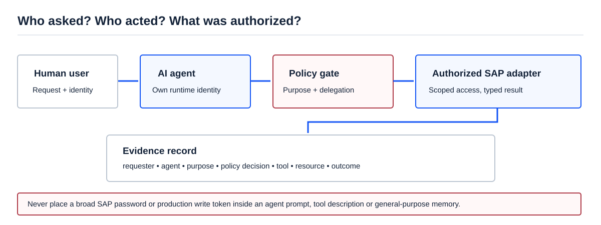

[AI Ready](/labs/ai-ready/) / [Video Lessons](/labs/ai-ready/video-lessons/)

# Your AI Agent Used a Token. Who Actually Did the Work?

**Source:** [Kamil Potrec (Keycard), “Who Is Making This Request? Agent Auth 101” — AI Engineer, 28 October 2026](https://www.youtube.com/watch?v=58ulJViGFgU) (18 min). [Searchable transcript](https://ainotes.us/summary/who-is-making-this-request-agent-auth-101-kamil-potrec-keycard).

Picture this: a user asks an assistant to **check** an invoice. The agent reads the invoice, decides it should be sent, and calls a write operation using the user's token. The backend sees a valid token. It cannot tell whether the user approved that extra action. This is the distinction the talk forces us to face: **authentication does not prove business intent**.

## Four identities are not one

<figure>

<figcaption>A model's decision is not an authorization decision. Put the permission check outside its prompt and retain the delegation chain.</figcaption>
</figure>

| Question | Who should answer it? | Why it matters |
| --- | --- | --- |
| Who requested the task? | Human identity / authenticated client | Establish the business requester. |
| Which agent performed it? | Runtime or workload identity | Distinguish software actors from people. |
| May this agent act for this user on this task? | Delegation policy / approval service | Prevent accidental privilege aggregation. |
| What reached SAP? | Authorized integration adapter and SAP audit evidence | Connect authorization to the real transaction. |

A technical SAP account, a human user, and an AI execution are **not interchangeable**. A single shared service user may be needed in some integration landscapes, but it makes the external audit trail, principal mapping, and operation scope more important—not less.

## The credential trap

Common shortcuts described in the talk include personal access tokens, static keys inside agent configurations, and middleware accounts with far broader access than any individual request needs.

The risks compound: a single agent can accumulate access across tools; static credentials may remain valid long after a task; and logs may show the API principal without the actual initiating actor.

The architecture alternative is to give the agent its own runtime identity and issue **short-lived, scoped access** only for an approved request. OAuth and workload identity federation can support this pattern where the systems and identity provider permit it. They do not automatically configure SAP authorization, ABAP roles, or a specific S/4HANA API.

## Synthetic SAP scenario: resend an outbound message

Request: *“Check why customer data is missing in the target system.”*

The agent finds a failed replication message and proposes a resend. Three outcomes must be separated:

- **Read:** inspect the source and target evidence under an explicitly allowed scope.
- **Propose:** present the specific object/message, reason and expected effect.
- **Execute:** a separate operation verifies requester authority, agent identity, approved message ID, relevant system permission, and retry safety before calling an authorized interface.

A human approval may be mandatory even if the agent is technically able to call the adapter. A successful transport response does **not** prove the target master data was updated correctly.

### An audit record worth keeping

~~~json
{
  "request_id": "SYN-REPL-018",
  "requester": "training-user",
  "agent_id": "mdg-diagnostics-readonly",
  "purpose": "diagnose_replication",
  "operation": "read_message_status",
  "scope": "synthetic-record-018",
  "policy_result": "allow",
  "approval_id": null,
  "outcome": "observation_recorded"
}
~~~

This is a conceptual audit schema. In a real system, avoid storing reusable access tokens or unrestricted payloads in audit events. Link to source-specific evidence with retention and access rules.

## The architect's options

| Pattern | Best fit | Limitation |
| --- | --- | --- |
| User-delegated authorization | Individual business actions with user context | Complex across legacy systems; delegation must be explicit. |
| Agent workload identity + policy | Background service, monitoring, scheduled tasks | Does not imply permission to act for every user. |
| Shared technical integration account behind a policy gateway | Existing SAP interface with limited authentication options | Needs strong per-request audit, narrow scope and external controls. |
| Broad service-account token passed into the LLM | **Not a recommended design** | Poor attribution and excessive blast radius. |

## 30-minute practical workshop

Design access for a **read-only SAP BP diagnostics assistant**. Write the allowed subjects, systems, objects, operations and retention. Then answer: what changes when business asks the agent to trigger `resend`?

Your answer should name the additional approval, technical write authorization, idempotency check, audit linkage and post-action verification. Do not solve the requirement by editing the system prompt.

**One-sentence architecture recommendation:** *Identify the agent separately, authorize each sensitive action against its delegated purpose, and keep production credentials behind an auditable adapter.*

**Related:** [Security and Governance](/labs/ai-ready/security-governance/) · [ERP Agent Gateway](/labs/business-ai/erp-agent-gateway/) · [Agent with Approval](/labs/ai-ready/labs/agent-approval/).

*Evidence boundary: the speaker describes the identity problem and possible authorization approaches. Specific SAP integration mechanisms depend on release, landscape and implementation. This page uses synthetic examples and remains unreviewed.*
