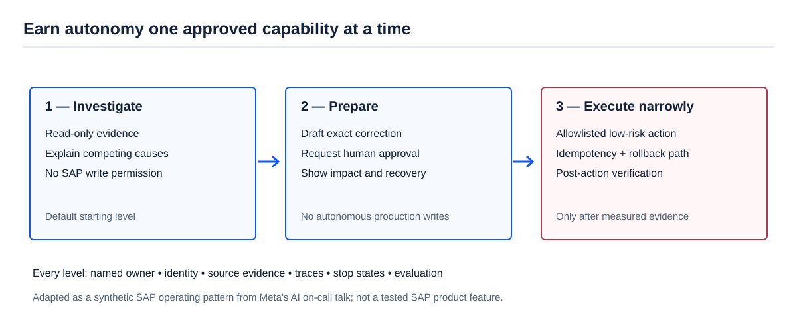

[AI Ready](/labs/ai-ready/) / [Video Lessons](/labs/ai-ready/video-lessons/)

# Give Your On-Call an AI Teammate, Not a Production Password

**Source:** Swaapnika Motapothula, Chinmay Gandhi and Vlad Tsvang (Meta), *“Give Your On-Call Its Own AI Teammate”*, AI Engineer, 10 November 2026 (15 min). [Talk overview](https://www.vibeleaderboard.ai/intel/9dbe16ee-174f-4b86-9b44-aa7ad0503051) · [AI Engineer channel](https://www.youtube.com/@aiDotEngineer).

Imagine starting an on-call shift with an assistant that already knows the recurring failure patterns, gathers useful logs and prepares an investigation before you open six monitoring tools. That is a much more credible first goal than promising the agent will automatically repair every production incident.

The Meta speakers describe an on-call AI teammate with a separate identity, persistent operational context and an **autonomy ladder**. The key detail is not the word “teammate”. It is the way responsibility grows only when the action becomes trustworthy.

## The autonomy ladder

<figure>

<figcaption>An SAP adaptation of the talk's autonomy progression. A higher level requires evidence and stronger controls; it is not the default.</figcaption>
</figure>

| Level | What the agent may do | What a person still owns |
| --- | --- | --- |
| **1 — Investigate** | Read alerts, search runbooks, correlate traces, compare causes | Diagnose ambiguous business impact and select corrective actions. |
| **2 — Prepare** | Create an evidence-backed change proposal, test plan or draft PR | Approve exact modifications and normal change-control gates. |
| **3 — Execute narrowly** | Perform a specifically approved low-risk action under an explicit policy | Authorize the capability, monitor it, stop or roll it back. |

Critical production decisions remain with accountable people. The talk describes an operating approach, not a measured cross-company guarantee of time savings. The real test is whether an agent improves investigation and reduces interruptions without creating new incidents.

## SAP example: replication looks healthy, the business disagrees

**Synthetic training case.** A BP update should reach an S/4HANA consumer. The source reports a successful outbound message, but a downstream business document still uses an old value.

A useful on-call assistant would:

1. Identify the requested business outcome: the correct attribute should be available **and used** in the target process.
2. Read source and target record snapshots, the message processing state and the relevant timestamps.
3. Compare two hypotheses: stale target data versus a later business-process determination issue.
4. Return the discrepancy, source references, what has not been proven and the probable owner.
5. Propose a narrow follow-up check. **Do not resend** until the change path is authorized and duplicate behavior is understood.

This is also a lesson in ownership: a successful interface log is a technical signal. It is **not** the final business outcome.

## What should the agent remember?

Useful memory is **not** an archive of everything employees once said. It is a short, reviewed record of stable operating information: current runbook pointers, previously verified failure patterns, escalation ownership and known environmental limitations.

Keep transitory evidence (a particular alert, document, batch or queue) in the incident record, with timestamps and access controls. Wrong memory can turn yesterday's hypothesis into today's “fact”. The speakers discuss promoting and retiring memory entries; implement that with review and expiry rules rather than automatic truth accumulation.

## Pilot design: start with one recurring incident type

| Element | Minimum useful choice |
| --- | --- |
| Trigger | A known alert type or manually submitted incident ID |
| Inputs | Synthetic or approved read-only logs and business-object snapshots |
| Output | Diagnosis candidates, evidence references, missing data and next action |
| Human owner | Named SAP support lead or interface owner |
| Limits | One case scope, time/call budget, no production write tools |
| Verification | Business-state recheck and reviewer judgment |
| Escalation | `missing_evidence`, `stale`, `permission_denied`, `uncertain` |

A useful objective for the pilot: **reduce investigator time spent gathering facts while maintaining or improving diagnostic accuracy**. Track median evidence-collection time, accepted diagnoses, escalations, unnecessary reads and cost per accepted case. Set thresholds from your baseline—do not borrow someone else's improvement percentage.

## 45-minute hands-on exercise

Build a synthetic dataset of ten incidents with three categories: integration failure, data mismatch and process determination issue. For each case, save four artifacts: source observation, target observation, expected owner and accepted next action.

Test a read-only assistant against a fixed manual checklist. Require the agent to cite a timestamped observation for every reported business fact. Penalize confident but unsupported fixes.

**Lead-level question:** The agent is right nine times out of ten. Is that enough for autonomous message resends? Explain risk severity, duplicate effects, approval, recoverability and the difference between diagnosis accuracy and safe execution.

**Related:** [SAP Agent Architecture](/labs/ai-ready/agent-architecture/) · [Agent with Approval](/labs/ai-ready/labs/agent-approval/) · [Safe Multi-Agent Handoffs](/labs/ai-ready/video-lessons/safe-multi-agent-handoffs/).

*Evidence boundary: the Meta speakers describe design principles and a ladder of autonomy. SAP cases and proposed evaluation are synthetic. This page is unreviewed study material.*
