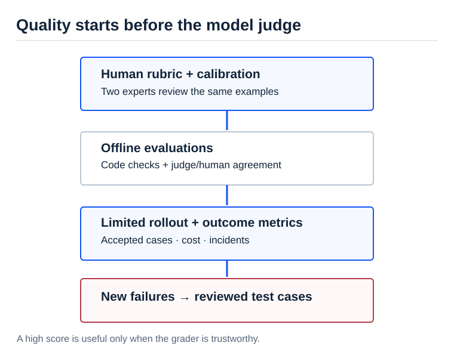

[AI Ready](/labs/ai-ready/) / [Video Lessons](/labs/ai-ready/video-lessons/)

# How Do You Evaluate an AI Answer with No Single Right Answer?

An agent suggests an architecture for a customer. Is it good? Two architects may disagree. One values simplicity; another worries about availability; a third sees a missing FI/CO dependency. A unit test cannot choose the winner.

In [How Netflix Evaluates AI When There's No Right Answer](https://aietalks.com/talks/how-netflix-evaluates-ai-when-theres-no-right-answer), Cameron Wolfe describes an evaluation loop for subjective output: human criteria, calibrated judges, offline tests, production signals and statistical caution. The transferable insight is **to define quality before automating its measurement**.

<figure>

<figcaption>A model judge is a useful proxy only after its agreement with trusted human examples has been examined.</figcaption>
</figure>

## The first evaluator must be calibrated people

Ask two SAP Leads to grade the same five architectural proposals without a rubric. They may use entirely different standards. The problem is not only the model—**the definition of a good answer is unstable**.

Define five criteria for a design recommendation:

| Criterion | Question | Check |
| --- | --- | --- |
| Business objective | Did it solve the business problem? | Named outcome and owner |
| Technical grounding | Does it distinguish facts, assumptions and release behavior? | Relevant evidence / documented uncertainty |
| Options and trade-offs | Were viable alternatives considered? | Cost, risk, complexity, maintainability |
| Controls | Are permissions, data ownership and recovery addressed? | Concrete boundary and failure handling |
| Decision quality | Is the recommendation defendable and actionable? | Clear next step, validation and decision owner |

Use a scale of 0–2 for each criterion with examples. A score of **0** means missing or wrong; **1** means partial; **2** means precise and supported. This gives a possible ten-point result, **but the score is a project-specific teaching rubric**. It is not a Netflix evaluation standard.

Have two qualified reviewers grade ten diverse examples, compare differences and resolve unclear criteria. Only then use those examples to calibrate a model judge.

## An LLM judge is a measuring instrument—not truth

A judge may prefer confident, polished writing to careful, incomplete answers. It can also agree with the evaluated model for the wrong reason. Test its agreement against human judgments, including *weak* answers and deliberately tricky cases.

**Do not report a single score as if it were exact.** Sample enough cases, repeat non-deterministic runs, and report ranges or confidence intervals appropriate to the data. A two-point difference on ten highly subjective examples is unlikely to justify a major production decision.

## A practical SAP evaluation ladder

~~~text
Qualified humans define quality
    -> calibrate and settle disagreements
    -> create a diverse reference set
    -> LLM judge + deterministic checks
    -> check judge/human agreement
    -> small controlled rollout
    -> business outcome and failure monitoring
    -> new reference cases
~~~

**Deterministic gates still win for checkable facts.** Does a file match a migration template? Use code. Is a mandatory field blank? Use a rule. Is an explanation understandable and honest about uncertainty? That may need a calibrated human or judge.

## A 60-minute exercise

Create 12 synthetic architecture recommendations: four strong, four mediocre, four misleading. Include at least two that sound confident but hide missing master-data or integration dependencies.

Have two reviewers grade them using the rubric above. Record their agreement **per criterion**, not just an overall average. Then ask an LLM to grade the same text with citations to the relevant sentence. Compare differences, revise the rubric and repeat on new cases.

**Success:** a judge that reliably escalates unsupported claims and agrees with experts on critical boundaries. **Failure:** high average scores for attractive but technically empty prose.

**Architect question:** If customer satisfaction improves but expert safety ratings worsen, which signal would govern rollout, and why?

Related: [Assessment Practice](/labs/assessment/) · [Evals and Reliability](/labs/ai-ready/evals-reliability/) · [Full speaker transcript](https://ainotes.us/summary/how-netflix-evaluates-ai-when-there-s-no-right-answer-cameron-wolfe-netflix).

**Source boundary:** The evaluation loop is described by Netflix's speaker. The SAP rubric and numerical exercise are original suggestions.

*Editorial status: working study material, pending human review; noindex. All SAP scenarios are synthetic.*
