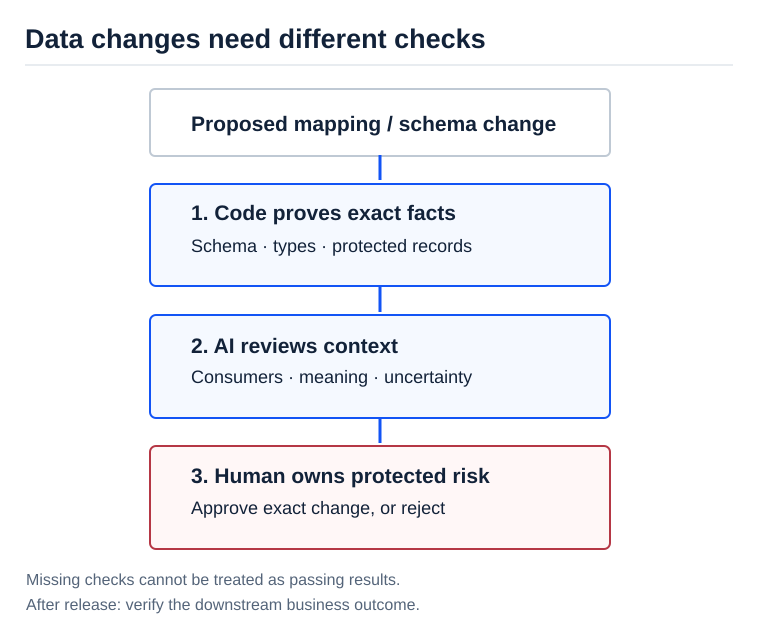

[AI Ready](/labs/ai-ready/) / [Video Lessons](/labs/ai-ready/video-lessons/)

# Let Rules Prove Facts, AI Review Context, and Humans Own Risk

Data teams can generate a pull request in minutes. Reviewing a risky schema or mapping change still requires someone who knows the dependencies. In [60% of Our Data PRs Now Merge With No Human Review](https://aietalks.com/talks/60-of-our-data-prs-now-merge-with-no-human-review), Chetas Joshi (Robinhood) describes a three-part review system: deterministic checks, contextual agent review, and protected human decisions.

Joshi reports that by **31 August 2026**, roughly 60% of eligible data pipeline PRs merged without a human reviewer, while sensitive changes still went to people. These are **company-reported operating metrics**, not a general release threshold.

<figure>

<figcaption>Deterministic checks, contextual judgment and protected approval solve different problems. A missing check is not a passing check.</figcaption>
</figure>

## Draw the three boundaries before installing an AI reviewer

| Duty | Owner | Examples |
| --- | --- | --- |
| **Prove** | Deterministic rules and current metadata | Schema compatibility, mandatory tags, known consumers, exact column properties, staging checks |
| **Judge** | Bounded, evidence-grounded agent | Undocumented dependencies, suspicious use of a changed field, plausible impact outside static metadata |
| **Decide** | Named human owner | Sensitive permissions, meaning changes, irreversible migrations, low-confidence or disputed findings |

The speaker notes an important failure: the independent script and agent layers did not share a full live picture of one another's health. If the agent *assumes* CI ran while CI actually failed, the architecture has a dangerous blind spot. Aggregate checks at the release gate and make "check did not run" distinct from "check passed".

## SAP-style case: master-data upload template change

**Synthetic example:** A helper generates a spreadsheet for mass update of customers. Its PR changes a mapping and adds a column called **Cutover Action**.

What can code prove?

- Header names, order and types still match the agreed upload interface.
- Known source-to-target mapping IDs resolve.
- Every changed cell is marked with a before/after value.
- A delete action cannot be emitted for a protected record.
- Example input yields expected output with no hidden column changes.

What requires expert judgment?

- Does **Cutover Action** mean keep the current value or override it at a later stage?
- Is the new mapping correct for all business segments?
- Does the change alter the meaning of a field used by a downstream process?

The model may **identify** a suspicious semantic dependency. It must not mark a conflicting business definition as approved simply because other tests passed.

## A compact PR risk record

~~~json
{
  "change_id": "SYN-DATA-PR-021",
  "deterministic_checks": {
    "schema": "pass",
    "mapping_resolution": "pass",
    "protected_records": "not_run"
  },
  "agent_review": {
    "finding": "possible_change_of_business_meaning",
    "evidence_refs": ["rule-catalog-v2", "mapping-diff-021"]
  },
  "decision": "human_review_required"
}
~~~

This is an educational contract, not a Robinhood product API. A `not_run` result is never silently converted to `pass`. Keep human approvals tied to the exact commit being merged.

## Two metrics, not one success percentage

Measure **dangerous misses** and **false escalations** separately. Escalating every change can reduce missed incidents while creating zero time savings. Approving everything is fast until a protected field is corrupted.

Use severity-weighted miss rate, proportion safely auto-reviewed, average reviewer time, rework and post-merge incidents. Keep the actual baseline and reviewed decision record. The reported 60% is not a target you should copy.

## A 60-minute lab for data architecture

Create 12 synthetic PRs that change field mappings, input column order, deletion handling, data-type widths and access tags. Write deterministic checks for at least four. Give the AI reviewer the PR diff plus verified metadata, not imaginary environment access.

Require human review for every semantic change, protected record or incomplete deterministic gate. Then add a hidden thirteenth case: an undocumented downstream reader of a field. Observe whether the AI surfaces uncertainty rather than claiming a complete lineage graph.

**Architect question:** When can a data migration pipeline merge without human review, and what change must never cross that boundary?

Related: [Data Relationship Map](https://github.com/dkharlanau/data-relationship-map) · [Mapping as Code](https://github.com/dkharlanau/mapping-as-code) · [Evidence-backed PRs](/labs/ai-ready/video-lessons/evidence-backed-ai-prs/) · [Source transcript](https://ainotes.us/summary/60-of-our-data-prs-now-merge-with-no-human-review-chetas-joshi-robinhood).

**Source boundary:** Robinhood's metrics, architecture and past incidents are speaker-reported. The SAP file example and proposed gate are synthetic.

*Editorial status: working study material, pending human review; noindex. All SAP scenarios are synthetic.*
