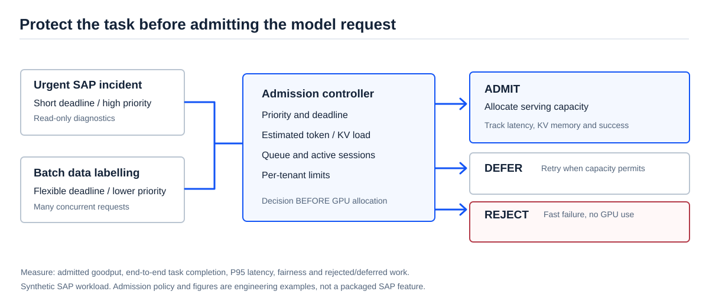

[AI Ready](/labs/ai-ready/) / [Video Lessons](/labs/ai-ready/video-lessons/)

# Your Self-Hosted LLM Must Learn to Say No

*Why letting every agent request through can destroy the performance of the tasks that matter.*

**Source:** [Harshul Jain (Audible) and Parv Khatri (SAP), "Your Self-Hosted LLM Needs to Say No"](https://www.youtube.com/watch?v=ntVpbyDTYaQ), AI Engineer, 9 November 2026 (52 min). [Searchable transcript](https://ainotes.us/summary/your-self-hosted-llm-needs-to-say-no-harshul-jain-parv-khatri-audible-sap) · [Talk overview](https://aietalks.com/talks/your-self-hosted-llm-needs-to-say-no).

One user asks an AI coding assistant to fix a test. The assistant launches many model calls: read a file, interpret an error, plan a change, inspect logs, repeat. Other agents do the same. Within seconds, a self-hosted inference server can have far more work than its GPU capacity can serve.

A simple API gateway might see many perfectly valid requests. The GPU sees a growing backlog, rising memory pressure, and tasks missing deadlines.

The speakers' main proposal is **admission control at the inference boundary**: decide to **admit, defer or reject** a request before it consumes expensive serving capacity. This is not a safety refusal based on the words in a prompt. It is **capacity and workload management**.

## 1. Why request counts are misleading

Two requests may look identical to a rate limiter but impose very different GPU load.

- A short question with a 100-token response has a different serving cost from a 12,000-token context followed by a long generated report.
- A generation uses a **KV cache** to retain attention-related state across tokens. Its memory demand depends on the model, token counts, batching and serving implementation.
- The server does not know the final generated length at the moment of acceptance.
- A paused or interrupted agent can retry, generating bursts that defeat a simple average requests-per-second budget.

This explains why **request rate** alone is a weak capacity signal. A workload-aware admission policy may consider estimated tokens, model/tenant, active sessions, queue pressure, memory limits, deadlines and priority.

<figure>

<figcaption>Admit, defer and reject are distinct operating decisions. Early rejection protects capacity but can also reduce completed work if the policy is too aggressive.</figcaption>
</figure>

## 2. The three decisions

| Decision | What it means | When it helps | What can go wrong |
| --- | --- | --- | --- |
| **Admit** | Accept now; reserve or schedule serving capacity | Enough capacity for useful work within its deadline | A long generation consumes more resources than expected |
| **Defer** | Ask the caller to try later or wait in a bounded queue | The task is valid but not urgent; capacity may return | A delayed task misses a business deadline |
| **Reject** | Decline now without allocating GPU memory | A request cannot be served acceptably under current constraints | Over-rejection hurts availability and customer experience |

A queue is not free. It stores waiting work and hides the fact that requests cannot complete soon enough. A well-operated system needs a queue limit, a timeout and a caller contract that distinguishes **retryable overload** from permanent rejection.

The talk discusses HTTP responses as practical signals. Do not assume a single status code, retry header or provider extension has universal semantics across all LLM frameworks.

## 3. Why the SLA belongs to the task, not only the model endpoint

Consider two workloads on the same private inference cluster.

**Task A — SAP AMS incident triage.** An on-call engineer needs a summary of a failed interface and the next authorized read. It must be useful during active support.

**Task B — Batch master-data classification.** A scheduled job labels 20,000 synthetic product descriptions. Most outputs can be processed later without business damage.

If Task B launches hundreds of concurrent LLM calls, raw first-in-first-out scheduling may slow Task A just when it matters. But Task A should not get unlimited priority either: a noisy tenant can monopolize the cluster.

The correct architecture separates **business priority**, **per-tenant budget**, **data sensitivity** and **operational deadline**. Those are policy inputs, not intuitive judgments by a chat model.

### An illustrative workload contract

~~~json
{
  "workload": "synthetic-sap-incident",
  "tenant": "sap-ams-demo",
  "priority": "high",
  "deadline_ms": 10000,
  "estimated_input_tokens": 3000,
  "max_output_tokens": 400,
  "requested_concurrency": 1,
  "fallback": "defer_or_human",
  "production_data": false
}
~~~

This is a training example, **not** a vLLM, SAP BTP or cloud-provider API. Enforce policy at the serving gateway. Do not assume a prompt saying “urgent” is a trustworthy priority signal.

## 4. How to measure a better policy

A policy that accepts only easy requests may report excellent latency and high success among *accepted* requests, while neglecting most users.

Measure the complete workload, including work that was deferred or rejected.

| Metric | Useful question |
| --- | --- |
| **Admitted goodput** | How much work finished within the agreed SLA, accounting for all arrivals and deferrals? |
| **P95 time to first token (TTFT)** | How long do admitted requests wait before the first visible output? |
| **End-to-end task completion** | Did the SAP investigation finish in time, not just one model call? |
| **Rejection/defer rate** | How many valid requests never ran or missed a useful window? |
| **Fairness by tenant and task** | Did bulk or high-priority traffic starve the rest? |
| **GPU/cache utilization** | Are we preserving capacity without unacceptable idle time? |
| **Cost per useful completed task** | Did the policy improve business value rather than a vanity throughput metric? |

The speakers present experimental results, including a notable latency improvement under selected admission policies. These are **speaker-reported demonstrations** with particular workloads and hardware, not portable capacity targets for SAP projects. Reproduce the baseline using your own traffic before claiming savings.

## 5. SAP architecture options

**Option 1 — Fully managed LLM provider.** The provider operates the serving fleet. Your application still needs task budgets, concurrency controls, retries, and degradation handling. You may not control admission inside its inference engine.

**Option 2 — Self-hosted model behind a gateway.** You control model placement, hardware, capacity policy, data routing and performance measurements. You also own GPU operations, scaling, upgrades, failures and cost. This is appropriate only when data residency, predictable throughput, latency, or economics justify it.

**Option 3 — Hybrid routing.** Small/low-risk work can run on one model or local serving tier; exceptional or complex investigations may use an approved alternative. The selection must respect data policies and cost limits; fallback cannot silently send private SAP data to an unauthorized provider.

For a first SAP AI pilot, **a hosted model with clear task budgets may be simpler**. Self-hosting is a product and operating-model decision, not an automatic security or cost advantage.

## 6. A 50-minute experiment with no production SAP system

Start with **synthetic arrivals**, not real customer records. Design three types of requests: urgent incident, ordinary support question, and batch data classification.

1. Generate a 100-request trace: include long/short contexts, high/low priority and a burst of 30 calls within a short window.
2. Simulate a server with a fixed number of concurrent slots and bounded queue. Estimate service time per task from input/output token categories.
3. Compare **FIFO**, **fixed concurrency only**, and **priority + deadline + defer/reject**.
4. Count tasks that finish within their individual deadlines. Include rejected and deferred arrivals in the denominator; report fairness separately.
5. Repeat with urgent traffic tripled. Verify that the policy still honors per-tenant caps.
6. Challenge the design: what happens if every client marks itself urgent, or if the model's output is much longer than estimated?

You can perform this exercise with a spreadsheet or a short Python script before deploying any inference engine. The goal is to expose trade-offs in an inspectable simulation.

### Decision record to produce

~~~text
Decision: Add bounded admission at the serving gateway.
Business reason: Protect support-triage deadlines during batch bursts.
Inputs: Authenticated tenant, task class, quota, token estimate, queue pressure.
Controls: Per-tenant limits, maximum queue age, retry contract, audit.
Fallback: Defer batch; show explicit overload to support user when needed.
Proof: Task goodput, P95 TTFT, rejects, fairness and cost versus FIFO.
Open risk: Long generation may exceed its estimated memory budget.
~~~

## 7. Explain it in a two-minute architecture interview

*“I would not solve inference overload by simply increasing rate limits or adding GPUs. First, I would characterize the workload: prompt length, output tokens, concurrent sessions, deadlines and tenant priority. Then I would compare bounded queues, workload-aware admission, and extra capacity against the same trace. For urgent SAP investigations, I would protect a measured latency objective without starving routine workloads. I would also define how clients handle deferral or rejection. Only after these results would I decide whether self-hosting and additional GPU spend are justified.”*

**A harder question:** What if rejecting 20% of requests improves P95 model latency but causes 10% of business incidents to miss their resolution SLA? Which metric should decide the architecture?

**Related:** [Agent Architecture](/labs/ai-ready/agent-architecture/) · [Token Economics](/labs/ai-ready/build-operate/#token-economics) · [Evals and Reliability](/labs/ai-ready/evals-reliability/) · [AI On-Call for SAP AMS](/labs/ai-ready/video-lessons/ai-oncall-sap-ams/).

*Evidence boundary: presentation examples and reported performance come from the speakers. The SAP workload, sample request contract, experiment and decision are original synthetic learning material. Human editorial review is pending.*
