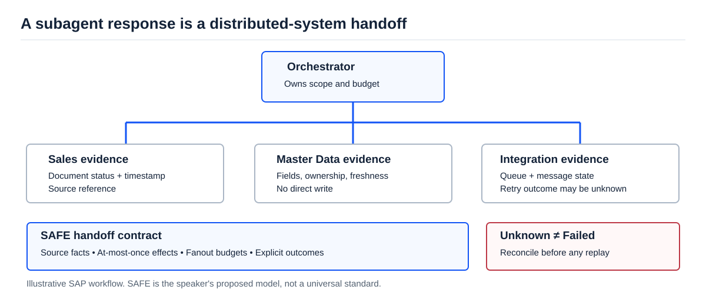

[AI Ready](/labs/ai-ready/) / [Video Lessons](/labs/ai-ready/video-lessons/)

# Your Subagents Are a Distributed System. Act Like It.

**Source:** Girish Konda (Microsoft), *“Your Sub-Agents Are a Distributed System. Treat Them Like One”*, AI Engineer, 10 November 2026 (23 min). [Transcript with timestamps](https://ainotes.us/summary/your-sub-agents-are-a-distributed-system-treat-them-like-one-girish-konda) · [AI Engineer channel](https://www.youtube.com/@aiDotEngineer).

An orchestrator asks three AI workers to investigate an incident. One returns a diagnosis, one times out, and one quietly created a support ticket before its result was lost. Can the orchestrator declare the task finished? Can it safely retry?

This is **not a prompt-writing problem**. It is a distributed-systems problem with an unreliable and partly unstructured response format.

## Four failures you will recognize

| Failure | Ordinary distributed system | What it looks like with agents |
| --- | --- | --- |
| Partial failure | One service stops midway | Worker returns polished text even though one tool failed. |
| Dirty read | Reading uncommitted shared state | Worker B treats Worker A's guess as a verified SAP fact. |
| Unbounded fanout | Requests overload a downstream dependency | Subagents keep spawning more reads against the same API. |
| Retry after unknown outcome | A write may have succeeded, but response was lost | Retry sends the same SAP message twice. |

The third one is a performance problem; the fourth can be a **business correctness problem**. When a transport response is missing, you cannot assume either that a write failed or that it succeeded.

<figure>

<figcaption>The proposed SAFE model makes handoffs explicit. It is a useful design heuristic, not a standard that guarantees exact-once delivery.</figcaption>
</figure>

## The speaker's SAFE handoff model

Girish proposes **SAFE** for subagents that touch external systems. Treat it as his design pattern, not a universal consistency standard.

- **S — Source facts.** Carry evidence references, timestamps and versions. Never promote a hypothesis into a fact without a source check.
- **A — At-most-once effects.** Give each write an identity and an exact approval; if the outcome is uncertain, reconcile instead of blindly replaying.
- **F — Fanout budgets.** Bound child-agent count, concurrent reads, downstream quotas, steps and retries.
- **E — Explicit outcomes.** Return named states such as `completed`, `partial`, `stale`, `unknown`, `denied`, `timeout`.

The model is deliberately limited. It does not validate the truth of a source, roll back partial changes, or deliver globally ordered results. With more than one independent orchestrator you also need a broader coordination design. If all workers only draft text for a human to review, much of this machinery may be unnecessary.

## SAP case: the reply vanished during DRF replication

**Synthetic example.** A diagnostic assistant requests a message resend through an approved adapter. The adapter sends a request, but the call times out before the agent receives the result.

There are at least three real possibilities:

1. The request never reached the target.
2. The request was processed, but the reply was lost.
3. Processing started and later failed downstream.

The agent knows only: **the outcome is unknown**. It must not conclude `failed` and submit another write. Instead, it should read authorized source/target status, correlate the transaction or business object, examine message processing and ask the integration owner for a safe next action.

### Handoff schema

~~~json
{
  "task_id": "SYN-REPL-019",
  "worker": "integration-reader",
  "status": "unknown",
  "source_refs": ["trace/synthetic-019"],
  "as_of": "2026-11-11T10:00:00Z",
  "effect": {
    "action": "resend_message",
    "operation_id": "synthetic-op-019",
    "attempted": true,
    "confirmed": false
  },
  "next_action": "reconcile_target_state"
}
~~~

The schema is illustrative. A real system needs consistent transaction identities and database-/middleware-level duplicate protection where supported. Calling a tool twice with the same prompt is not idempotency.

## Three non-negotiable invariants

| Invariant | How to test it |
| --- | --- |
| A worker's claim is not business evidence without a source reference. | Return a plausible diagnosis without a source ID; the orchestrator must reject it as confirmed. |
| An uncertain write must not be automatically repeated. | Simulate a timeout after a successful write; assert that no second write occurs without reconciliation. |
| Subagents must respect a shared resource budget. | Fan out beyond the configured concurrency and call budget; expect a controlled `budget_exhausted` outcome. |

## 45-minute hands-on lab

Create two mock tools: `read_message_status(id)` and `request_retry(id)`. The second tool should simulate three outcomes: success, explicit failure, and **success followed by a lost reply**. Add an orchestrator that accepts only typed worker results.

Now run four fixtures: normal processing, missing source data, lost reply, and duplicate retry request. The success criterion is **zero unintended second writes**, not “the agent always gives an answer”.

**Architect question:** If the business insists that a resend always happens within 30 seconds, how do you handle an unknown outcome without risking duplicate downstream updates? Which SLA should change?

**Related:** [Agent Architecture](/labs/ai-ready/agent-architecture/) · [Standard Agents](/labs/ai-ready/standard-agents/) · [ERP Agent Gateway](/labs/business-ai/erp-agent-gateway/).

*Evidence boundary: SAFE is the speaker's proposal. SAP examples are synthetic and must not be interpreted as release-independent transaction semantics. Human review is pending.*
